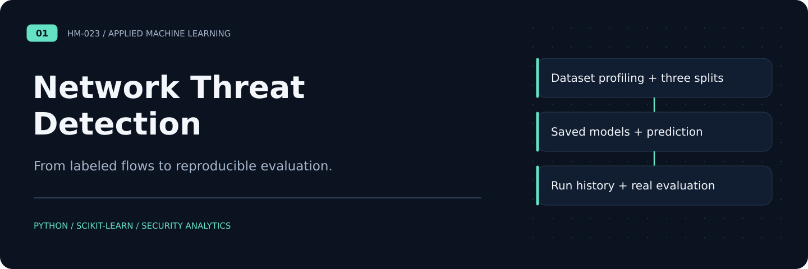
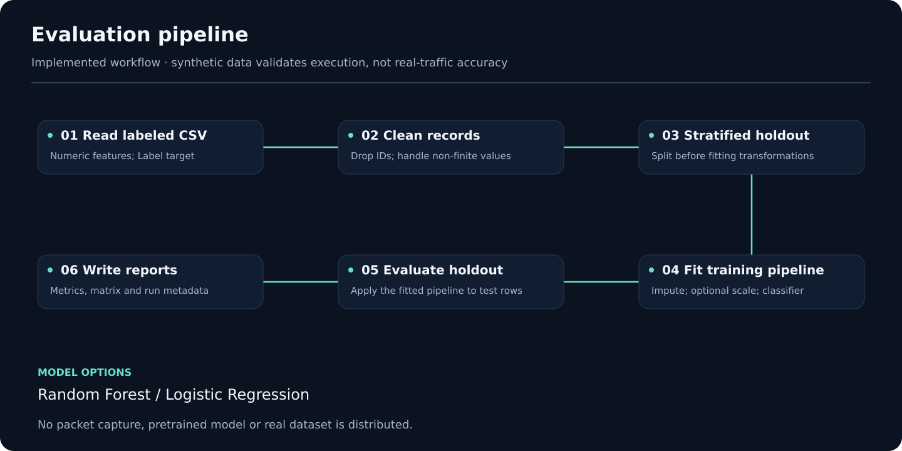

# Network Threat Detection

**Local ML experiment workspace** · [User guide](docs/workspace-guide.md) · [Architecture](docs/workspace-architecture.md) · [Verification](docs/workspace-verification.md) · [Portfolio](https://github.com/HM-023)

[](https://github.com/HM-023/NetworkThreatDetection/actions/workflows/workspace.yml)

CSV class balance, missing numeric values and feature summaries. The repository now includes a working, browser-based local workspace with a responsive dashboard and persistent records.

## What you can do

| Capability | Working behavior |
|:---|:---|
| **Dataset inspection** | CSV class balance, missing numeric values and feature summaries. |
| **Real experiment training** | Random Forest and Logistic Regression with train-only fitted preprocessing. |
| **Split control** | Random stratified, group-disjoint and chronological holdouts. |
| **Evaluation** | Per-class metrics, confusion matrices and protocol fingerprints for comparing like-for-like runs. |
| **Saved-model prediction** | Predict from workspace-generated model artifacts; arbitrary model uploads are rejected. |
| **Persistent history** | SQLite experiment metadata, local model artifacts and JSON report exports. |

## Run locally

Requires **Python 3.11+**. Run commands from this repository's root:

```bash
python -m venv .venv
# Windows PowerShell: .venv\Scripts\Activate.ps1
# macOS/Linux: source .venv/bin/activate
python -m pip install -r requirements.txt
python -m webapp.app
```

Open **http://127.0.0.1:8101** in your browser. Stop the server with `Ctrl+C`.

Four workspaces use only Python's standard library. The ML workspace uses the packages in `requirements.txt`. The browser UI loads no external fonts, scripts, analytics or services. After dependencies are installed, the applications run offline.

For a different local port or data directory:

```bash
python -m webapp.app --port 8201 --data-dir path/to/local-workspace
```

## Architecture



The server binds to loopback, checks the Host header and requires a fresh per-process token for API access. Mutations also reject foreign browser origins. Local data lives under `data/` by default; database files, model files and generated outputs are excluded from version control.

## Verify the implementation

```bash
python -m unittest discover -s tests -v
```

The [workspace workflow](https://github.com/HM-023/NetworkThreatDetection/actions/workflows/workspace.yml) runs domain tests and an automated browser journey on GitHub. Browser runs upload real desktop and mobile captures as the **workspace-screenshots** artifact. See the verification document for the exact tested boundaries.

## Implementation boundaries

The original Python training CLI remains available. The studio adds a local user interface and persisted experiments; it does not capture packets or monitor a network. Real-traffic quality depends on licensed data, labels and an appropriate independent evaluation.

These are local portfolio applications, with documented scope and tested workflows. They are not deployed enterprise services. No synthetic model score is presented as a real-world detection benchmark, and no generated network diagram or policy decision is presented as live network evidence.

## Repository map

| Path | Purpose |
|:---|:---|
| `webapp/app.py` | Application actions and local workspace state |
| `webapp/runtime.py` | Loopback HTTP boundary and SQLite document storage |
| `webapp/static/` | Responsive dashboard, forms, tables, charts and exports |
| `tests/` | Domain, persistence, server-boundary and browser checks |
| `docs/workspace-guide.md` | Usage, input formats and local-data operations |
| `docs/reference-case-study.md` | Prior case study, historical context and attribution |

## Provenance and reuse

The workspace code and generic examples are newly authored. Historical collaborative source materials, private datasets, credentials and organization-specific documents remain excluded. The [reference case study](docs/reference-case-study.md), [publication notes](PUBLICATION_NOTES.md) and existing security guidance retain the original contribution and reuse boundaries. No blanket license has been added to historical material.

The original CLI remains available: `python -m src.train --help`.
